## Forensic

## Stonks

### Scénario

> A major real estate and development corporation is under investigation for large-scale financial fraud. The company allegedly inflated revenues and concealed massive debt in order to secure bank loans and push through a stock exchange listing. Public reports painted a picture of strong growth, but the truth tells otherwise. Law enforcement has seized a corporate server believed to store critical documents. However, investigators suspect that the original financial statements reflecting the company's real losses were deleted in an attempt to cover up the fraud. As a digital forensics specialist, your mission is to recover the missing file and bring the hidden truth to light.

On nous fournit le système au format AD1.

```bash
file evidence.ad1
evidence.ad1: data
```

J'ai ouvert l'image avec FTK Imager.

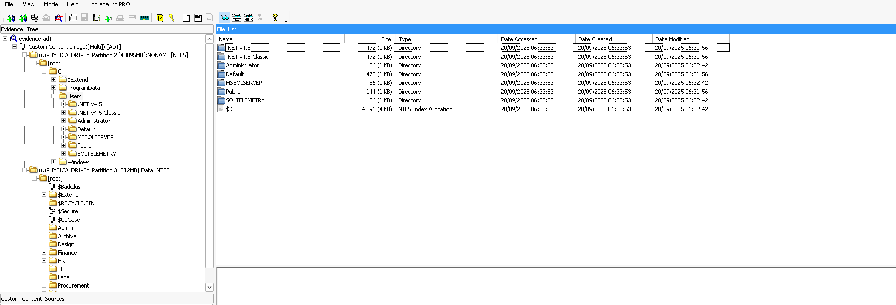

---

### Task 1 - When was the Windows Data Deduplication feature first installed on the system?

Selon la documentation Microsoft, la déduplication des données consiste à identifier et supprimer les copies redondantes de données afin de réduire l'espace de stockage nécessaire.

Pour cette question, je savais que les journaux EVTX devraient conserver l'heure d'installation du service. J'ai donc parsé tout le dossier des événements avec EvtxECmd :

```bash
wine ~/Downloads/tools/Eric/EvtxeCmd/EvtxECmd.exe -d logs --csv out_evtx
```

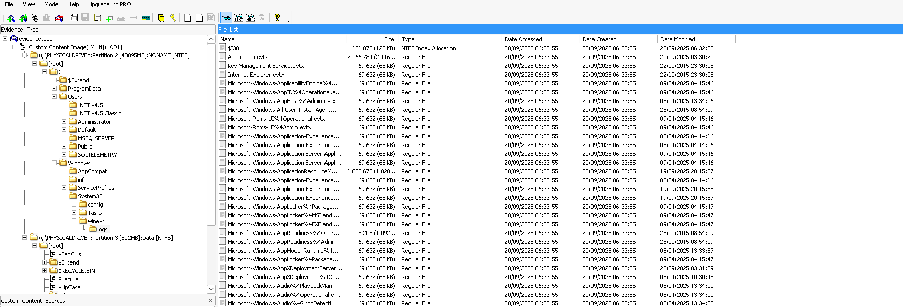

J'ai ensuite ouvert le CSV avec Timeline Explorer, cherché l'EventID d'installation de service, puis filtré sur l'ID et le nom du service :

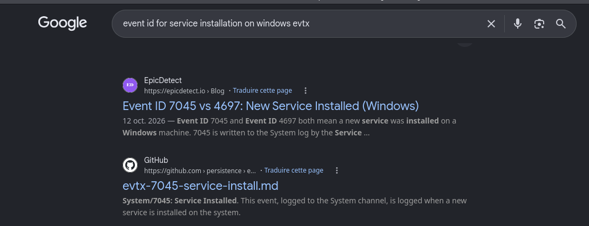
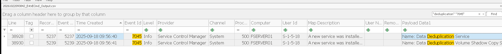

Réponse : **2025-09-18 09:56:40**

---

### Task 2 - How many bytes of disk space were saved after the first optimization job was completed by Data Deduplication?

En cherchant comment obtenir ces informations, je suis tombé sur la documentation Microsoft qui explique que l'on peut consulter la progression d'un job de déduplication, l'espace économisé sur le volume et l'état du processus avec les cmdlets PowerShell `Get-DedupStatus` et `Get-DedupVolume`.

En lisant cette documentation, on voit que l'espace économisé apparaît dans la sortie de la commande, sous le nom `SavedSpace`.

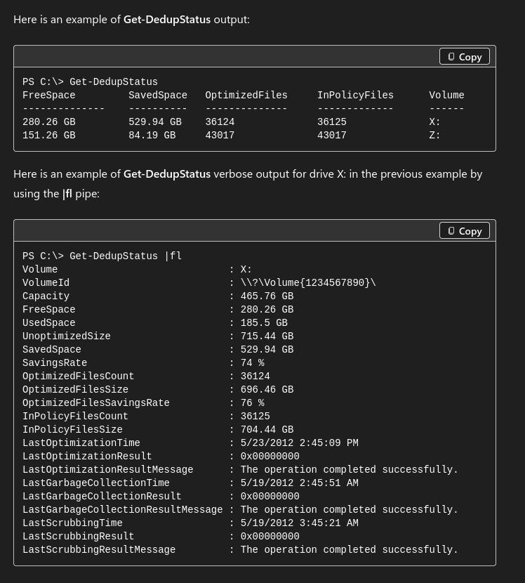

J'ai donc filtré les logs sur le jour de l'installation, avec ce nom.

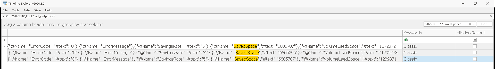

Réponse : **6805707**

---

### Task 3 - When was Data Deduplication most recently re-enabled on volume D:?

J'ai passé beaucoup de temps sur cette question, par manque de compréhension du fonctionnement du service.

J'ai d'abord cherché l'EventID de réactivation d'un service :

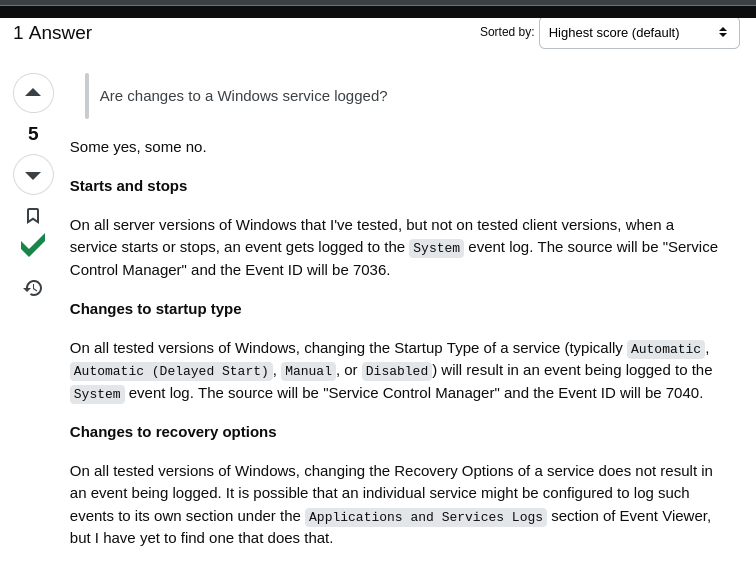

Je n'ai rien trouvé de concluant dans nos logs. En poursuivant mes recherches, je suis tombé sur la commande `Enable-DedupVolume` pour l'activation :

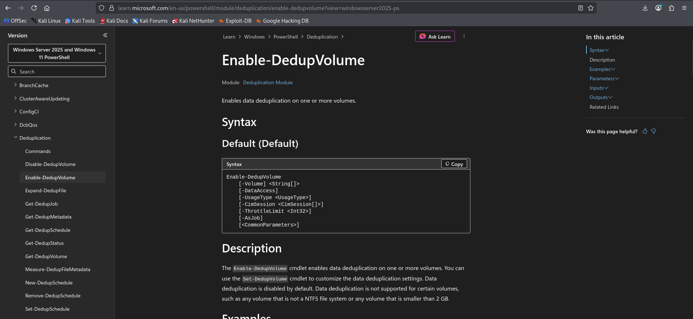

Mais le filtrage des logs sur cette commande n'a rien donné :

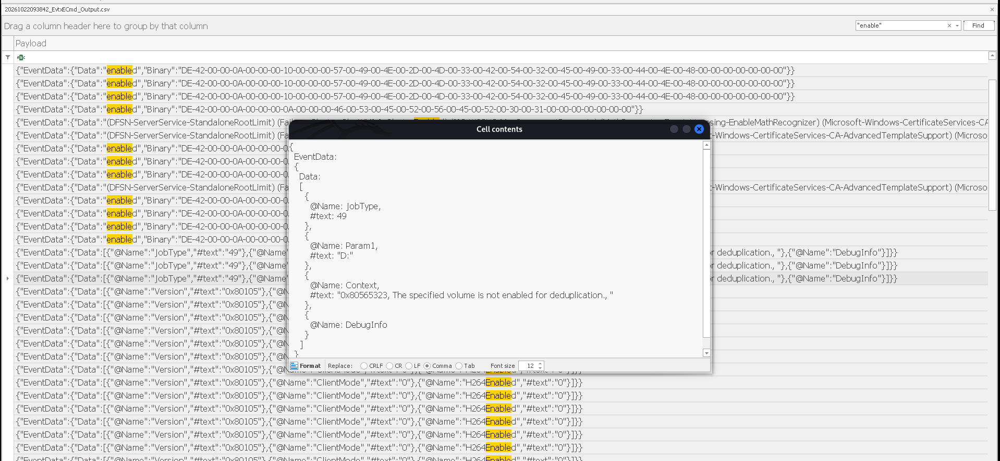

La documentation Microsoft évoque le dossier `System Volume Information` et le stockage des blocs, notamment lorsque le magasin de blocs devient volumineux ou rencontre des problèmes. J'ai donc vérifié ce que contenait ce dossier :

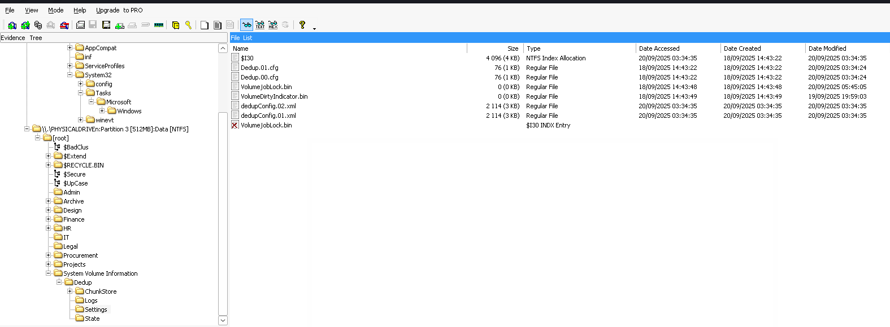

Les fichiers de configuration sont normalement créés lorsque Windows initialise ou écrit la configuration de Data Deduplication pour un volume. J'ai donc utilisé la date de création de ces fichiers de configuration.

Réponse : **2025-09-20 03:34:35**

---

### Task 4 - List all file extensions that are not optimized by Data Deduplication in alphabetical order.

Le fichier de configuration contient cette information :

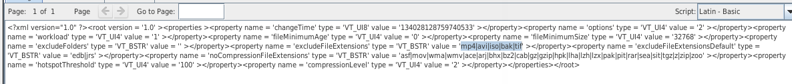

Réponse : **avi, bak, edb, iso, jrs, mp4, tif**

---

### Task 5 - How many files have been optimized by Data Deduplication?

On sait maintenant que la déduplication a été réactivée le 2025-09-20 à 03:34:35. Il faut chercher dans les logs l'événement correspondant à l'opération de déduplication.

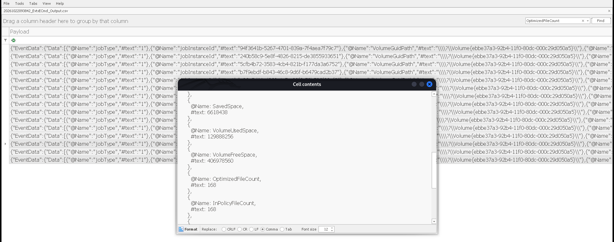

Réponse : **168**

---

### Task 6 - When is the next Throughput Optimisation job scheduled to run?

Consultons les tâches planifiées du service dans `System32\Tasks` :

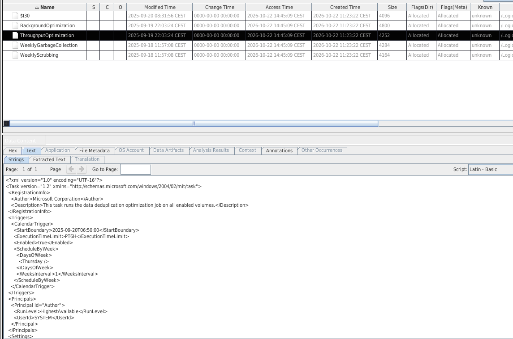

```xml
<ScheduleByWeek>
  <DaysOfWeek>
    <Thursday />
  </DaysOfWeek>
  <WeeksInterval>1</WeeksInterval>
</ScheduleByWeek>
```

- `<Thursday />` : la tâche s'exécute le jeudi.
- `<WeeksInterval>1</WeeksInterval>` : la répétition est hebdomadaire.

La tâche est donc planifiée chaque jeudi, à l'heure définie par `<StartBoundary>2025-09-20T06:50:00</StartBoundary>`. La prochaine exécution est le jeudi 25.

Réponse : **2025-09-25 06:50:00**

---

### Task 7 - What is the name of the financial report that was recently deleted in an attempt to cover up criminal activity?

Pour les tâches liées aux fichiers, je commence par consulter la MFT :

```bash
wine ~/Downloads/tools/Eric/MFTECmd.exe -f "\$MFT"
```

NB : le journal NTFS à analyser est celui de la **deuxième** partition, et non de la première. C'est sur la deuxième que se trouvent les données de la boîte.

En filtrant sur les fichiers qui ne sont plus en utilisation, un seul enregistrement ressort :

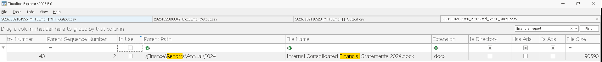

Réponse : **Internal Consolidated Financial Statements 2024.docx**

---

### Task 8 - What is the MFT entry number of that report file?

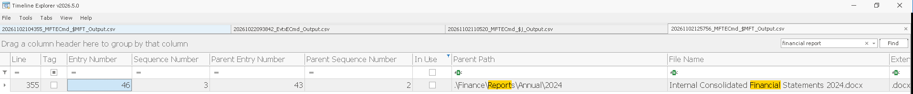

Réponse : **46**

---

### Task 9 - List all the FILE_ATTRIBUTE flags that are set on the report file. Submit answer in ascending order based on the hex value of each flag.

Comme on connaît déjà le numéro d'entrée MFT, on peut utiliser MFTECmd avec l'option `--de` pour obtenir plus de détails :

```bash
wine ~/Downloads/tools/Eric/MFTECmd.exe -f '$MFT' --de 46
```

La section **STANDARD INFO** indique :

Flags: Archive, SparseFile, ReparsePoint, Max Version: 0x0, Flags 2: None, Class Id: 0x0, Owner Id: 0x0, Security Id: 0x10C, Quota charged: 0x0, Update sequence #: 0x0


Réponse : **FILE_ATTRIBUTE_ARCHIVE, FILE_ATTRIBUTE_SPARSE_FILE, FILE_ATTRIBUTE_REPARSE_POINT**

---

### Task 10 - At what offset in the $MFT file does the $REPARSE_POINT attribute of the report begin? (Answer as an 8-digit hexadecimal offset, prefixed with 0x)

J'ai relancé MFTECmd en mode debug et filtré sur `ReparsePoint` :

```bash
wine ~/Downloads/tools/Eric/MFTECmd.exe -f '$MFT' --de 46 --debug | grep -i ReparsePoint
```


Dans le résultat précédent, on a vu `Entry-seq #: 0x2E-0x3, Offset: 0xB800`. L'entrée MFT n°46 commence donc à `0xB800`. Une entrée MFT occupe 1024 octets (0x400), donc sa fin est à `0xB800 + 0x400 = 0xBBFF`.

Tous les attributs de cette entrée doivent se trouver dans cette plage. Parmi les offsets retournés, un seul tombe dans `0xB800 - 0xBBFF` : `0xB9B0`.

Réponse : **0x0000b9b0**

---

### Task 11 - After the report was optimized by Data Deduplication, into how many chunks was its data divided?

Pour répondre à cette question, je me suis référé à cette recherche : [Windows Data Deduplication](https://7h3kn0w3r.github.io/blog/windows-data-deduplication/). Je vous invite fortement à la lire pour comprendre le fonctionnement de la déduplication sous Windows. Je ne reprends pas ici tous les détails.

Le workflow de cette recherche a été automatisé avec l'outil [DedupInspector](https://github.com/7h3kn0w3r/DedupInspector). Il faut l'installer pour la suite. NB : l'outil ne fonctionne que sous Windows.

`~/Downloads/tools/DedupInspector/build/bin/Release/DedupExplorer.exe`


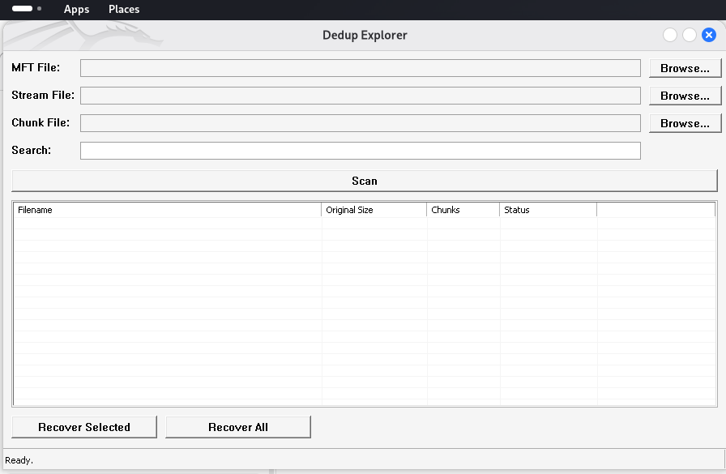

Le `$MFT` permet d'identifier le fichier et ses métadonnées de déduplication. Le Stream permet de retrouver les morceaux qui le composent, et le Chunk Store contient les données de ces morceaux.

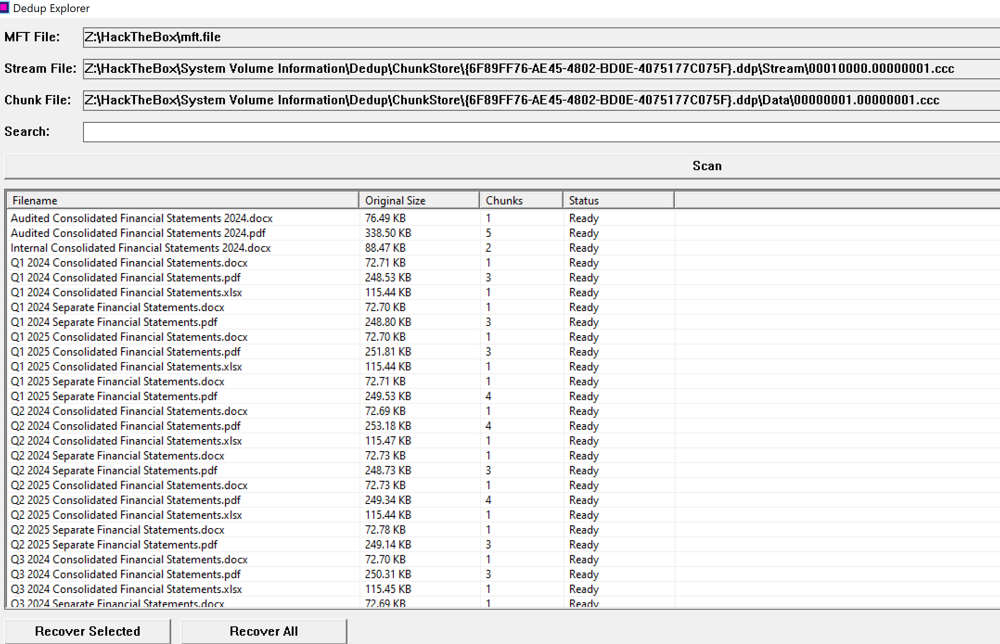
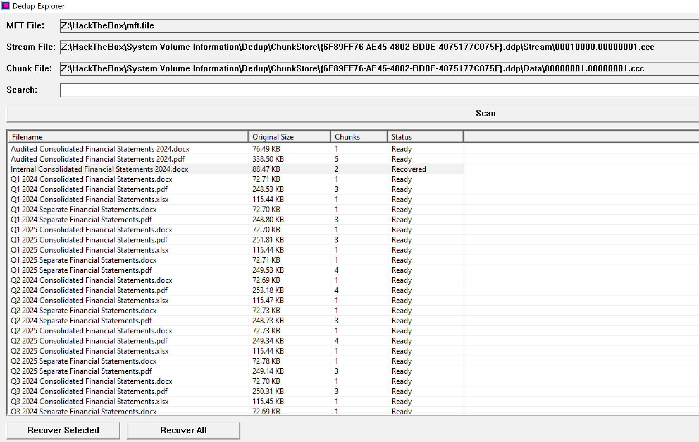

D'après ces résultats, le fichier est divisé en **2 chunks**.

Réponse : **2**

---

### Task 12 - What is the data length in bytes of the first deduplicated chunk belonging to the report file under investigation?

Ce guide m'a beaucoup aidé pour cette question : [Forensic Analysis of Deduplicated File Systems (DFRWS 2017)](https://dfrws.org/sites/default/files/session-files/2017_EU_paper_forensic_analysis_of_deduplicated_file_systems.pdf).

Ce qu'on sait déjà :
- le `$REPARSE_POINT` commence à l'offset `0xB9B0` dans la MFT ;
- le fichier est réparti en 2 chunks.

Méthode utilisée, inspirée du guide :

1. Les deux fichiers `.ccc` sont :
   - `00010000.00000001.ccc` : conteneur de flux (Stream Container) ;
   - `00000001.00000001.ccc` : conteneur de données (Data Container).

2. Le `$REPARSE_POINT` du fichier `Internal Consolidated Financial Statements 2024.docx` se trouve à l'offset `0xB9B0`.

3. On extrait l'identifiant du fichier :

   `F0 97 3C BB 3C 2B 95 86 4E E8 40 9F 58 68 79 17 C2 B1 86 5E 01 75 73 1E 68 95 F7 80 8C 86 7D 19`

4. On recherche cet identifiant dans le conteneur de flux. Il se trouve à l'offset `0x5298`. Le Ckhr associé est à `0x5260` et le Smap commence à `0x52C8`.

5. On lit les entrées du Smap pour retrouver les enregistrements Ckhr dans le conteneur de données :
   - premier Ckhr à l'offset `0x6CE20` ;
   - second Ckhr à l'offset `0x7BD20`.

6. On lit les tailles indiquées dans les enregistrements :
   - `A7 EE 00 00` en little-endian donne `0xEEA7`, soit **61 095 octets** ;
   - la deuxième entrée indique `0x733A`, soit 29 498 octets.

7. Vérification : 61 095 + 29 498 = 90 593 octets, ce qui correspond exactement à la taille du fichier indiquée dans la MFT. Le fichier est donc bien réparti en deux chunks.

Réponse : **61095**

---

### Task 13 - After recovering the file, provide the SHA-256 hash of the recovered financial report.

J'avais déjà extrait le fichier avec DedupInspector.

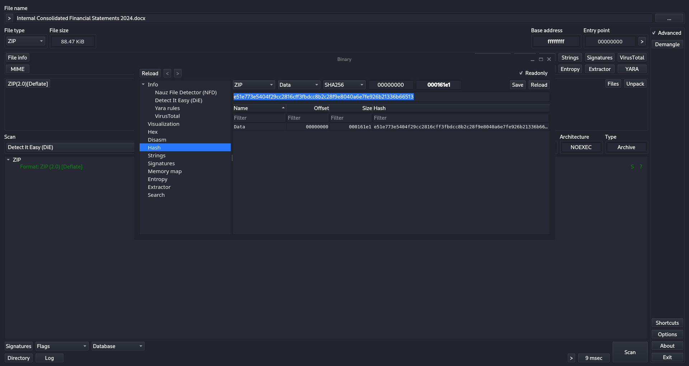

Réponse : **e51e773e5404f29cc2816cff3fbdcc8b2c28f9e8040a6e7fe926b21336b66513**

---

### Task 14 - The person who drafted this report must also be held legally accountable. What is their full name?

Un fichier `.docx` est une archive ZIP. Il suffit de le décompresser et de chercher l'auteur dans le dossier `docProps` :

```bash
cd docProps
strings * | grep -i creator
```

```xml
<dc:creator>Elaine Chua - Senior Accountant</dc:creator><cp:lastModifiedBy>Elaine Chua - Senior Accountant</cp:lastModifiedBy>
```

Réponse : **Elaine Chua**

---

### Task 15 - How much was the profit for the year overstated in the audited report compared to the actual one?

J'ai exporté le `.docx` du rapport d'audit avec DedupInspector.

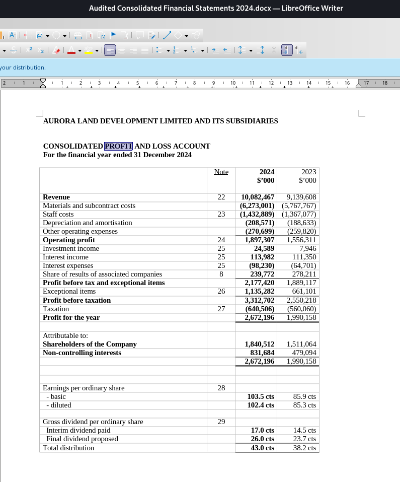
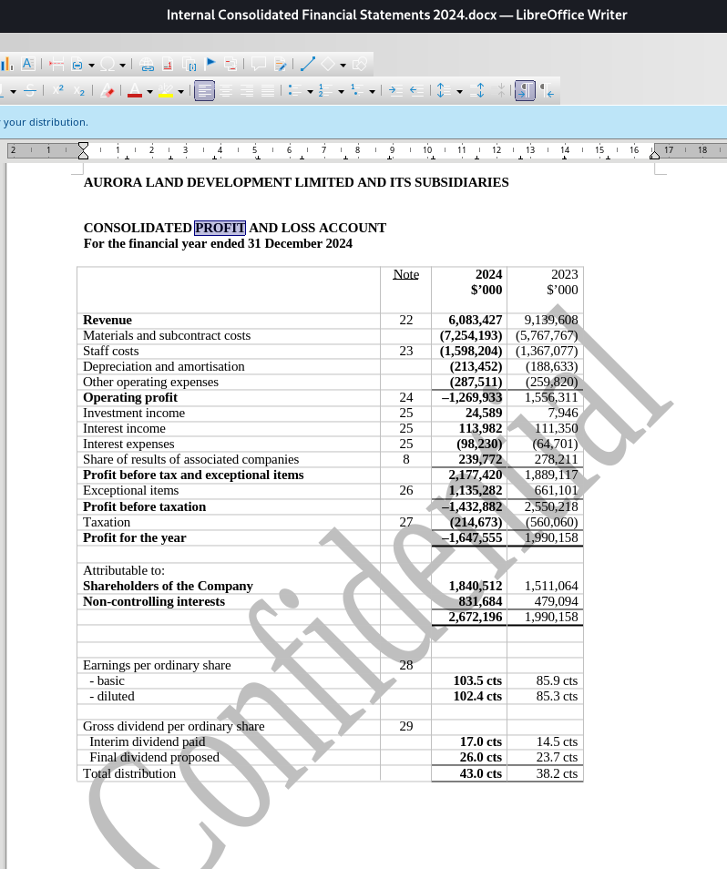

On prend le bénéfice indiqué dans le rapport audité, soit `2 672 196`, et on soustrait le résultat réel du document original, soit `-1 647 555` :

2672196 - (-1647555) = 4319751


Réponse : **4319751**